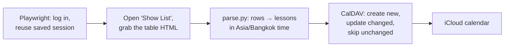

# Krutoo → iCloud Calendar Sync

[](https://github.com/Tarmk/KrutooPlannerApple/actions/workflows/ci.yml)

[](LICENSE)

Logs in to the KRUTOO school portal with Playwright, reads the "Show List" timetable, and writes every lesson into an iCloud calendar over CalDAV, so lessons appear on iPhone, Mac and Apple Watch without typing them in.

**Status:** during my last school year this ran every 15 minutes on a self-hosted Windows runner. I have since graduated, so the schedule is off and the Actions workflow is manual (**Run workflow**). The code still works for anyone with a KRUTOO account.

## How it works



- **Scraping** ([`sync/krutooschool_scraper.py`](sync/krutooschool_scraper.py)). The login is saved to `storage_state.json` and reused, so most runs skip the login form. The form sometimes ignores the first submit, so it tries twice. If the Show List button is disabled because no date range is set, it fills in the next 30 days. Screenshots and HTML of each failure go to `artifacts/` (uploaded by the workflow).
- **Parsing** ([`sync/parse.py`](sync/parse.py)). Columns are found by header name, so the order of columns does not matter, and both separate Start/End columns and a single "13.00 - 14.30" time column work. Duplicate rows (the list repeats rows while scrolling) and unparseable rows are dropped.
- **Calendar** ([`sync/icloud_caldav.py`](sync/icloud_caldav.py)). Each lesson gets a stable UID from its date, times, course, teacher and student, so re-runs never duplicate events. Changed lessons are updated in place; unchanged ones are not written at all. Events not created by this tool are left alone.

## Run it locally

```bash
git clone https://github.com/Tarmk/KrutooPlannerApple.git
cd KrutooPlannerApple
python -m venv .venv
source .venv/bin/activate          # Windows: .venv\Scripts\activate
pip install -r requirements.txt
python -m playwright install chromium

export KRUTOO_USERNAME=... KRUTOO_PASSWORD=...
python -m sync.main --dry-run      # scrape and print the lessons, iCloud untouched

export ICLOUD_USERNAME=... ICLOUD_APP_PASSWORD=...   # optional: ICLOUD_CALENDAR_NAME=KRUTOO
python -m sync.main                # scrape and sync
```

`ICLOUD_APP_PASSWORD` is an [app-specific password](https://support.apple.com/en-us/102654), not your Apple ID password. If `ICLOUD_CALENDAR_NAME` does not exist it is created.

Other options: `PLAYWRIGHT_HEADLESS=false` shows the browser, `PLAYWRIGHT_STORAGE_STATE=path` moves the saved login, and `python -m sync.main --html saved_page.html` parses a page you saved yourself instead of logging in.

`storage_state.json` (your saved login) and `artifacts/` are git-ignored. Never commit them.

## Run it on GitHub Actions

1. Add repository secrets: `KRUTOO_USERNAME`, `KRUTOO_PASSWORD`, `ICLOUD_USERNAME`, `ICLOUD_APP_PASSWORD`, and optionally `ICLOUD_CALENDAR_NAME`.
2. In `.github/workflows/krutoo-sync.yml`, change `runs-on: [self-hosted, Windows]` to `windows-latest` unless you have your own runner, and add a schedule back if you want it automatic:

   ```yaml
   on:
     workflow_dispatch: {}
     schedule:
       - cron: "*/15 * * * *"
   ```

3. Start it from the Actions tab with **Run workflow**.

## Development

```bash
pip install -r requirements-dev.txt   # no Playwright needed
pytest
ruff check . && ruff format --check .
```

The tests parse a saved sample timetable (`tests/fixtures/timetable.html`) and sync into a fake calendar, so they need neither a KRUTOO account nor iCloud. CI also runs a `--dry-run` against the sample page.

## License

MIT, see [LICENSE](LICENSE).
